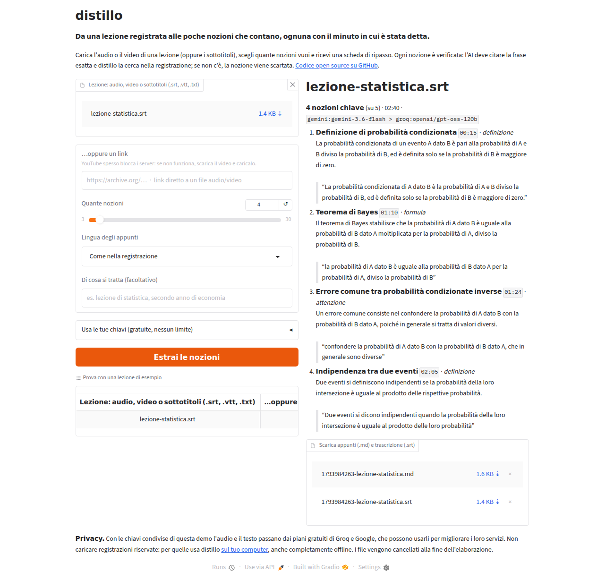

<div align="center">

# distillo

**An hour of lecture in, the handful of things worth learning out. Each one linked to the second it was said.**

distillo turns lectures, online courses, podcasts and meeting recordings into a short, ranked list of
key points: definitions, formulas, facts, procedures and warnings. You choose how many: 5 for a quick
review, 30 for a full revision sheet. It runs **free** on the Gemini and Groq free tiers, or **fully offline**.

[](https://github.com/AndreaAcanfora/distillo/actions/workflows/ci.yml)
[](https://pypi.org/project/distillo/)
[](https://github.com/AndreaAcanfora/distillo/blob/master/pyproject.toml)
[](https://github.com/AndreaAcanfora/distillo/blob/master/LICENSE)
[](https://www.paypal.com/paypalme/AndreaAca)

</div>

---

A real 81-minute university lecture (archives law, in Italian, from [archive.org](https://archive.org/details/Lezione6LegislazioneArchiviStefanoTwardzik),
CC BY-NC-SA), straight from the link, on the free tiers. It took 5½ minutes from link to notes:

```console
$ distillo "https://archive.org/download/Lezione6LegislazioneArchiviStefanoTwardzik/lezione_6_lezione_twardzik_10_11_09.mp3" -n 8 --lang it
```

```markdown
# lezione_6_lezione_twardzik_10_11_09

**8 nozioni chiave** (su 53) · 1:21:02 · `gemini:gemini-3.6-flash, groq:openai/gpt-oss-120b`

2. **Definizione di versamento archivistico** `02:39` · _definizione_
   Il versamento rappresenta il trasferimento della responsabilità delle serie archivistiche dagli uffici dell'amministrazione attiva (statali, amministrativi e giudiziari) all'amministrazione archivistica che afferisce al Ministero dei beni culturali.

   > “I versamenti sono questi trasferimenti di responsabilità di serie archivistiche dalla responsabilità dell'amministrazione attiva, degli uffici statali, amministrative, giudiziali, all'amministrazione archivistica”

3. **Termine ordinario dei 40 anni per i versamenti** `07:41` · _procedura_
   Secondo la normativa vigente, i versamenti dei documenti conservati negli archivi di deposito delle amministrazioni attive verso gli Archivi di Stato o l'Archivio Centrale dello Stato devono avvenire di norma 40 anni dopo l'esaurimento degli affari relativi.

   > “la legge prescite 40 anni dopo l'esaurimento degli affari. cioè prima i documenti stanno negli archivi di deposito”

6. **Segreto funzionale** `44:38` · _definizione_
   Il segreto funzionale è un tipo di segreto imposto dal presidente e dalla commissione parlamentare d'inchiesta sulla produzione documentaria, ma non è previsto da una norma di diritto positivo; è distinto dal segreto d'ufficio, che è disciplinato dal codice penale e da sanzioni amministrative.

   > “questo tipo di segreto che viene posto dal Presidente e dalla Commissione parlamentare d'inchiesta sulla documentazione prodotta è un segreto funzionale... non esiste una norma di diritto positivo che parli di questo segreto funzionale”
...
```

_Real output, three of the eight points shown. 9 of the 69 points the model proposed were dropped because their quote
was not in the recording._

## Web demo

A small web interface (Gradio, Italian) is in [`demo/`](https://github.com/AndreaAcanfora/distillo/tree/master/demo): upload a lecture or paste a link, choose how many
points, download the notes. It runs locally, and is ready for Hugging Face Spaces:

```bash
pip install -r demo/requirements.txt
GEMINI_API_KEY=... GROQ_API_KEY=... python demo/app.py      # http://localhost:7860
```



## Why another summarizer?

Most AI summarizers give you a paragraph you can't check. distillo is built for studying:

- **You choose the density.** `--points 5` or `--density low|medium|high` (about 6, 12 or 24 points per hour).
  Every candidate point is ranked once, so the 5 points are always the top 5 of the 20. Changing the number reuses
  the cached ranking: it is instant and free.
- **Every point is grounded.** The model must quote the transcript word for word. distillo looks the quote up with
  fuzzy matching. If it isn't there, the point is dropped as a probable hallucination. If it is there, the quote
  tells us *when* the point was made, so the timestamp comes from the recording, not from the model's guess.
- **Duplicates are merged.** Teachers repeat the important things. Repetitions become one point, linked to the
  first time it was said.
- **Free, or private.** Gemini and Groq free tiers, with automatic fallback from one to the other when you hit
  a quota. Or `--provider ollama --transcriber local` to keep a recorded lesson on your machine.
- **Notes in your language.** A lecture in English, notes in Italian: `--lang it`.

## Install

```bash
pipx install distillo              # or: uv tool install distillo
pipx install "distillo[local]"     # + offline transcription
```

From source:

```bash
git clone https://github.com/AndreaAcanfora/distillo && cd distillo
uv sync && uv run distillo --help
```

## Set up a free model (two minutes)

distillo needs a language model to read the transcript. The free tiers are more than enough for lectures:

| Provider | Free key | Used for |
| --- | --- | --- |
| **Gemini** | [aistudio.google.com/apikey](https://aistudio.google.com/apikey) | key points (first choice) |
| **Groq** | [console.groq.com/keys](https://console.groq.com/keys) | key points (fallback) **and** speech-to-text with Whisper large-v3-turbo |

```bash
export GEMINI_API_KEY=...   # also read: GOOGLE_API_KEY, GOOGLE_GENERATIVE_AI_API_KEY
export GROQ_API_KEY=...
```

With both keys, `--provider auto` (the default) uses Gemini (`gemini-3.6-flash`) and moves to Groq
(`openai/gpt-oss-120b`) when Gemini is overloaded, rate limited or out of quota. Groq's free tier allows 8,000 tokens
per minute, so distillo sends it smaller pieces, one at a time: a 40-minute lecture takes about two minutes.

With `ANTHROPIC_API_KEY` set, Claude is added at the end of the chain. You can also pick a provider explicitly:

```bash
distillo talk.mp3 --provider anthropic                       # claude-opus-5-5
distillo talk.mp3 --provider anthropic -m claude-haiku-5-5   # cheaper
distillo talk.mp3 --provider ollama -m qwen3:8b              # local, nothing leaves your machine
```

> Free tiers may use your prompts to improve the provider's products. For recordings that must stay private,
> use `--provider ollama --transcriber local`.

## Usage

```bash
distillo lesson.mp4                                  # ~12 points per hour, in the spoken language
distillo lesson.mp4 -n 5                             # exactly 5 points
distillo lesson.mp4 --density high --lang en         # dense notes, in English
distillo lesson.mp4 -c "2nd year organic chemistry"  # context helps the model
distillo lesson.mp4 -o notes.md --save-transcript lesson.srt
distillo lesson.srt -n 20 --order rank               # reuse the transcript, most important first
distillo "https://www.youtube.com/watch?v=VIDEO_ID" -n 10   # a link: captions if any, else the audio
distillo captions.vtt --link "https://youtu.be/VIDEO_ID?t={seconds}"   # clickable timestamps
distillo lesson.mp4 -f json                          # for scripts and other apps
```

Inputs: any audio or video file, `.srt` / `.vtt` subtitles, plain `.txt` transcripts (no timestamps), or a link.

### Links

YouTube and the [other sites yt-dlp supports](https://github.com/yt-dlp/yt-dlp/blob/master/supportedsites.md)
(Vimeo, archive.org, many university platforms, direct links to media files). If the video has captions in the
spoken language, distillo uses them and skips transcription; otherwise it downloads only the audio. YouTube
timestamps become links to the exact second. Use `--no-captions` to transcribe even when captions exist (automatic
captions have no punctuation), and `--cookies-from-browser firefox` if YouTube asks you to sign in, which happens
on servers and VPNs.

### Speech to text

| `--transcriber` | How | Notes |
| --- | --- | --- |
| `auto` (default) | Groq if `GROQ_API_KEY` is set, otherwise local | |
| `groq` | Whisper large-v3-turbo on Groq | fast, free; larger files are compressed and split automatically |
| `local` | [faster-whisper](https://github.com/SYSTRAN/faster-whisper) on your CPU/GPU | needs `distillo[local]`; `--whisper-model tiny…large-v3` |

Groq accepts uploads up to 25 MB. Bigger recordings (a video, a WAV, a two-hour lecture) are converted to mono
Opus at 24 kbit/s, about 11 MB per hour, and split into one-hour parts whose timestamps are joined back together.

## How it works

```text
audio/video ──Whisper──▶ timed transcript ──split──▶ parts of ~15 min
                                                         │ extract: every candidate point + verbatim quote
                                                         ▼
                                    grounding: find each quote in the transcript (fuzzy match)
                                       ├── not found → dropped (probable invention)
                                       └── found → timestamp of the matching segment
                                                         │ one ranking call over all points:
                                                         ▼ merge duplicates, order by importance
                                              top N ──▶ Markdown or JSON
```

Model responses are cached in `~/.cache/distillo` (override with `DISTILLO_CACHE_DIR`), so trying a different number
of points or another output format costs nothing. `--no-cache` forces fresh answers.

## Roadmap

- [x] v0.1: files and subtitles, Whisper (Groq or local), grounded points, density, merge, Markdown/JSON, free providers with fallback
- [x] v0.2: links (YouTube and other sites, captions when available), automatic compression and splitting for Groq
- [x] Web demo (Gradio, Italian interface)
- [x] PyPI release
- [ ] Hosted demo on Hugging Face Spaces
- [ ] Chapters for long recordings
- [ ] Anki deck export and self-test questions
- [ ] `--merge` several lectures into one course revision sheet

## Contributing

Issues and pull requests are welcome. See [CONTRIBUTING.md](https://github.com/AndreaAcanfora/distillo/blob/master/CONTRIBUTING.md): the test suite needs no API key.

## Support

distillo is free and open source. If it saves you hours of re-watching lectures, you can
[buy me a coffee on PayPal](https://www.paypal.com/paypalme/AndreaAca). Thank you!

## License

[MIT](https://github.com/AndreaAcanfora/distillo/blob/master/LICENSE) © Andrea Acanfora
